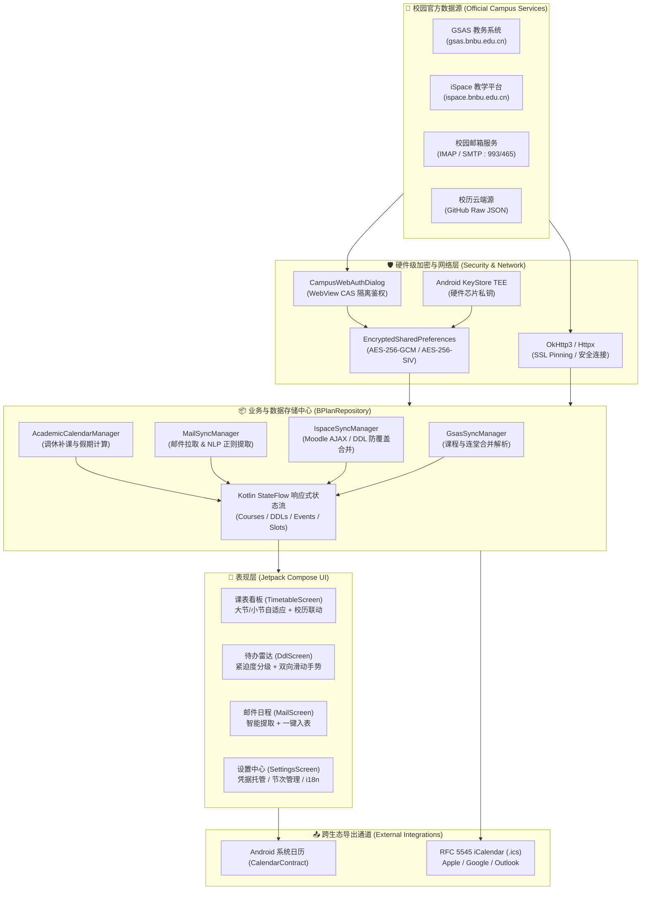

<div align="center">

# 📅 B-Plan (北师香港浸会大学校园日程助手)

**专为 BNBU (北师香港浸会大学) 学子打造的一体化、隐私优先、跨平台校园日程与学业待办助手。**

<p align="center">
  <a href="https://github.com/fall2wish/B-Plan/releases"></a>
  <a href="https://developer.android.com/about/versions/oreo"></a>
  <a href="https://kotlinlang.org"></a>
  <a href="https://developer.android.com/jetpack/compose"></a>
  <a href="https://m3.material.io"></a>
  <a href="https://www.python.org"></a>
  <a href="#-硬件级安全与隐私哲学"></a>
  <a href="LICENSE"></a>
  <a href="https://github.com/fall2wish/B-Plan/pulls"></a>
</p>

<p align="center">
  <a href="#-核心特性">核心特性</a> •
  <a href="#-界面预览">界面预览</a> •
  <a href="#-系统架构">系统架构</a> •
  <a href="#-快速开始">快速开始</a> •
  <a href="#-使用指南">使用指南</a> •
  <a href="#-硬件级安全与隐私哲学">隐私与安全</a> •
  <a href="#-项目结构">项目结构</a> •
  <a href="#-开源许可与免责声明">开源许可</a>
</p>

<p align="center">
  <sub>English readers: Please see the <a href="#-english-summary">English Summary</a> section below.</sub>
</p>

</div>

---

## 📖 项目背景与愿景

在日常校园生活中，BNBU 同学经常面临校园信息高度分散的痛点：
* **教务系统 (GSAS)** 承载了官方课表，但手机端查阅不便，且无法自动识别单双周、调休补课与辅导课；
* **教学平台 (iSpace / Moodle)** 汇总了海量作业与项目，但截止时间 (DDL) 容易遗漏，已提交状态与附件不易快速回溯；
* **校园邮箱** 每周收到大量讲座、学术研讨会、社团活动与行政通知，却需要手动一条条复制到日历；
* **校历调休机制** 繁琐，法定假期与自主阅读周（Reading Week）、周末补课安排难以在普通课表软件中自动换算。

**B-Plan** 由此应运而生。它不是一个单纯的本地课表工具，而是**深度适配 BNBU 数字化校园生态的学业日程中枢**。软件基于现代 Android 架构设计（Jetpack Compose + Material 3），同时配套 Python 服务引擎，以**本地离线优先**和**芯片级硬件安全隔离**为底座，为同学们提供流畅、纯粹、无广告、零隐私泄露风险的校园日程管理体验。

---

## ✨ 核心特性

### 1. 🎓 智能教务课表 (Smart Timetable)
* **教务数据直接解析**：支持与 GSAS 教务系统直连，自动抓取并解析个人课表 JSON 报文，智能合并多节连堂课程与单双周课程。
* **双模式排课与作息自适应**：
  * **研究生模式**：内置上午 (09:00-11:50)、下午 (14:00-16:50)、晚上 (18:00-20:50) 三大节沉浸式作息；
  * **本科生模式**：标准 45 分钟小节次，支持自由增加、删除、调整起止时间与节次名称，多节次时间重叠自动按时间升序重排。
* **官方校历与调休智能适配**：内置 2026/27 第一学期校历，自动识别中秋节、国庆节、元旦法定假期停课，并在调休补课日（如 9月20日补第四周 9月25日双数周周五课、10月10日补第六周 10月5日周一课）**自动无感切换对应课表及单双周映射**。
* **自主阅读周 (Reading Week) 精准分流**：拒绝“一棒子打死”，精准区分学生身份（本科生 UG vs 研究生 PG）。本科生在第 8 周享受停课自修，课表自动标记放假；研究生在自主阅读周不放假，课程教学、实验考核正常排课提醒。支持登录自动推断培养层次与随时手动切换。
* **官方校历原图双向核对机制**：结构化校历与 GitHub 仓库官方核准原图（含校教务委员会批复与公章）实时链接，端内支持一键调出高分辨率核对窗口，缩放核对排课无误。

### 2. ⏰ iSpace 作业与 DDL 雷达 (Deadline Radar)
* **Moodle 原生数据同步**：直连 iSpace AJAX 时间线接口与 iCalendar 订阅源，实时抓取近期作业与考核任务。
* **紧迫度动态预警**：按剩余时间高亮显示状态（24小时内紧急红色、3天内橙色预警、进行中正常显示），附带动态倒计时。
* **作业提交详情与凭据查看**：实时核对 Moodle 评分状态、提交时间戳及已上传附件列表（文件名、大小、下载链接），交作业无需重复打开网页确认。
* **防覆盖合并保护**：智能识别本地用户推迟修改的截止时间，保留手动勾选完成态；支持**永久排除名单**，彻底删除的待办后续同步永不反弹。
* **双向滑动手势**：卡片支持左右滑动快捷操作（标记完成 / 延后截止日 / 永久排除）。

### 3. 📬 校园邮件智能日程提取 (Smart Campus Mail)
* **标准邮件协议集成**：原生支持 IMAP / SMTP 协议，直接连接 BNBU 校园邮箱（腾讯企业邮架构），支持 SSL/TLS 安全加密与即时同步。
* **智能正则 NLP 解析**：内置针对 BNBU 校园定制的语义提取引擎，自动识别邮件文本中的：
  * **时间信息**：支持中英文绝对日期、相对周次、上午/下午时间段解析；
  * **校园地点**：智能识别 T1~T8、V 栋教学楼、行政楼、CC 演艺厅、LRC 图书馆等校园地标；
  * **日程附件**：自动解析邮件携带的 `.ics` (vCalendar) 日程邀请文件。
* **一键加入日程**：解析到的讲座或活动可一键添加到个人日程视图，或直接调起 Android 系统日历设置闹钟提醒。

### 4. 🔒 硬件芯片级隐私安全 (Hardware-Backed Security)
* **TEE / StrongBox 独立芯片**：认证凭据由 Android KeyStore 硬件加密引擎托管，主系统与应用沙盒均无法导出物理私钥。
* **AES-256-GCM 硬件认证加密**：学号、密码采用工业级加密存储，严格遵循 Android UID 沙盒隔离。
* **零云端传输**：所有教务、Moodle、邮件数据与凭证**仅在手机本地与校园官方服务器直连**，无任何第三方中转服务器，`allowBackup="false"` 杜绝 ADB 与云备份泄露。
* **安全会话隔离**：内置安全 Web 认证通道，支持 CAS 单点登录与图形验证码交互，支持随时一键抹除所有 Token 与本地 Web 缓存。

### 5. 📆 全格式日历导出与跨平台联动 (RFC 5545 iCalendar)
* **标准 ICS 导出**：可将 16 周全学期课表、Tutorial 及个人自定义日程一键导出为标准的 `.ics` 文件。
* **跨设备全生态无缝同步**：一键导入至 **Apple 日历 (iOS / iPadOS / macOS)**、**Google Calendar**、**Microsoft Outlook** 或小米/华为/OPPO/vivo 系统自带日历。

### 6. 🌐 现代用户体验与三语国际化 (Modern UX & i18n)
* **Material 3 规范**：遵循 Google 最新 Material You 设计语言，融入 BNBU Navy 与 Blue 专属校园主题色。
* **多语言即时切换**：原生支持 **简体中文**、**繁體中文** 与 **English**，无需重启应用即刻生效。
* **离线优先**：无网络环境下课表与待办秒开，具备网络时后台静默差量更新。

### 7. 🛡️ 法律合规与知情同意机制 (Legal Compliance & Informed Consent)
* **强制知情同意弹窗**：依据《中华人民共和国个人信息保护法》(PIPL) 与《民法典》格式条款提示义务，首次启动或未签署协议前强制展示《用户须知与免责协议》。
* **支持「不同意，仅浏览」模式 (Browse-Only Mode)**：
  * 若用户选择不同意协议，软件仍友好允许进入应用主界面进行浏览，但**全面锁定教务与教学平台同步、日程与 DDL 创建修改、邮箱收发与凭据保存等一切功能**；
  * 用户可以查阅新建课程、新建日程等表单界面，但保存或提交动作将被系统级拦截并弹出解锁提示；
  * **零存储写入保证**：在签署协议前，应用内存中的任何临时状态均不会向手机存储或 SharedPreferences 写入任何文件，保障用户彻底的隐私自主权与无痕体验；
  * **会话级重新确认**：仅浏览状态为纯内存会话，每次应用冷启动均会重新提示协议，直至用户明确知情签署。

---

## 🏗️ 系统架构

B-Plan 采用清晰的分层解耦与单向数据流（UDF）架构：



---

## 🚀 快速开始

### 方式一：直接安装 Android 安装包 (推荐普通用户)
1. 前往本项目的 [Releases 页面](https://github.com/fall2wish/B-Plan/releases) 下载最新版本的 `B-Plan-v1.0.0.apk`。
2. 在 Android 手机上打开并允许“未知来源应用安装”（支持 Android 8.0 及以上版本）。
3. 安装完成后打开应用，在【设置】页面完成校园统一身份认证即可开始使用。

---

### 方式二：从源码编译构建 Android 应用 (适合开发者)

#### 环境要求
* **Android Studio**: Iguana (2023.2.1) 或更高版本
* **JDK**: OpenJDK 17 或 Temurin 17
* **Android SDK**: `compileSdk = 34`, `minSdk = 26`
* **Gradle**: 8.2+

#### 构建步骤
```bash
# 1. 克隆代码仓库
git clone https://github.com/fall2wish/B-Plan.git
cd B-Plan/android

# 2. 编译并生成 Debug APK
./gradlew assembleDebug

# 3. 若已连接真机或启动模拟器，可直接安装运行
./gradlew installDebug
```
编译产物位于 `android/app/build/outputs/apk/debug/app-debug.apk`。

---

### 方式三：使用 Python 后端与抓取服务组件

本项目在 `services/` 目录下配备了与 Android 核心逻辑对齐的 Python 客户端引擎，便于自动化测试、反向工程与本地数据调试。

```bash
# 1. 切换至项目根目录并创建虚拟环境
python -m venv .venv
source .venv/bin/activate  # Windows: .venv\Scripts\activate

# 2. 安装依赖
pip install -r requirements.txt
# 或者使用现代包管理器 uv:
uv pip install -r requirements.txt

# 3. 复制环境变量模板并填入账号信息
cp .env.example .env

# 4. 运行全套单元测试
pytest
```

---

## 🛠️ 使用指南

### 1. 校园身份绑定与 SSO 授权
1. 切换到底部导航栏的 **【设置】** 页面；
2. 点击顶部的 **【点击绑定校园身份】**；
3. 输入你的 BNBU 学号与校园统一身份认证密码；
4. 密码将即刻存入手机 TEE 安全硬件芯片（AES-256-GCM 加密）；随后系统将调起安全的校园统一身份认证 WebView 窗口获取授权令牌，完成课表与作业的静默拉取。

### 2. 课表模式与节次作息调整
* **切换作息预设**：在【设置】->【课程节次时间设置】中，研究生同学可直接选择“恢复默认三大节 (09:00-11:50 / 14:00-16:50 / 18:00-20:50)”，本科生同学可自定义 45 分钟标准节次。
* **自由微调**：点击任意节次可单独修改名称与起止时间，支持多节时间重叠，保存后系统将自动按起止时间升序重新排列序号。

### 3. 校历调休与自主阅读周
* 应用默认内置 **2026/27 第一学期官方校历**。
* 当处于 **中秋节调休 (9月20日周日)** 或 **国庆节调休 (10月10日周六)** 时，课表顶部将自动展示对应调休徽标，并**自动展示补课日所对应的周五/周一课程**。
* 在第 8 周 **自主阅读周 (Reading Week)**，课表将自动提示放假停课，避免因误看常规周课表跑空教室。
* 支持在设置中一键同步云端最新校历 JSON。

### 4. 校园邮箱与智能日程提取
1. 在【设置】或【邮件日程】页面右上角点击齿轮，配置你的校园邮箱；
2. 填入你的学号邮箱（例如 `xxxxxx@mail.bnbu.edu.cn`）以及邮箱专用密码；
3. 服务器地址默认配置为腾讯企业邮服务器：
   * **IMAP 接收服务器**: `mail.bnbu.edu.cn` / 端口 `993` (SSL)
   * **SMTP 发送服务器**: `mail.bnbu.edu.cn` / 端口 `465` (SSL)
4. 点击测试连接并保存。刷新邮件列表后，系统会自动用高亮徽章标出检测到的**讲座时间、地点与日程**，点击即可一键加入日程表。

### 5. 导出到系统日历与全平台联动
* **单项日程导出**：在课表或 DDL 详情弹窗中，点击“添加到系统日历”即可自动唤醒系统日历应用并预填时间、地点与备注；
* **全量 ICS 导出**：在【设置】->【数据安全与导出】中，点击“导出 ICS 课表文件”，可生成包含 16 周所有课程与日程的标准 `.ics` 文件，通过微信/AirDrop/邮件发送到 iOS 设备或电脑端直接导入。

---

## 🔒 硬件级安全与隐私哲学

<div align="center">
  
</div>

作为一款处理学生教务凭据与学业数据的工具，**隐私与安全是 B-Plan 的生命线**：

1. **绝对零云端存储**：B-Plan 没有自建后端用户中心，不设任何收集学生账号密码的远程中间服务器。所有网络请求均直接发生在用户手机与校园官方服务器之间。
2. **硬件级 KeyStore TEE 隔离**：凭据保存基于 Android `EncryptedSharedPreferences` 与 `MasterKey`，密钥存放在设备物理隔离的安全芯片（TEE / StrongBox）中，即使手机被 Root 或提取 ROM，攻击者也无法导出物理密钥。
3. **内存即用即焚**：解密明文仅在发起校园鉴权请求的毫秒级生命周期内驻留内存，网络请求完毕后立即由垃圾回收器释放。
4. **禁止系统备份泄漏**：清单文件显式声明 `android:allowBackup="false"`，防止通过电脑 ADB 备份、手机克隆等手段绕过沙盒导出用户数据。
5. **代码全开源**：所有网络通信逻辑、加密存储逻辑完全开源，可接受任何审计与监督。

---

## 📁 项目结构

```
B-Plan/
├── android/                         # Android 端完整工程 (Jetpack Compose)
│   ├── app/
│   │   ├── build.gradle.kts         # 依赖配置与构建脚本
│   │   └── src/
│   │       ├── main/
│   │       │   ├── AndroidManifest.xml
│   │       │   ├── java/cn/edu/bnbu/bplan/
│   │       │   │   ├── MainActivity.kt               # 主入口与底部导航 Scaffold
│   │       │   │   ├── data/
│   │       │   │   │   ├── model/                    # 数据模型 (Course, Ddl, Email, Calendar)
│   │       │   │   │   ├── repository/               # 数据仓库与各服务同步管理器 (Repository Pattern)
│   │       │   │   │   └── security/                 # TEE 硬件芯片级 AES-256 加密凭据管理器
│   │       │   │   ├── ui/
│   │       │   │   │   ├── components/               # 可复用 Compose 组件 (卡片、弹窗、手势滑块)
│   │       │   │   │   ├── screens/                  # 四大主页面 (Timetable, Ddl, Mail, Settings)
│   │       │   │   │   └── theme/                    # BNBU 主题色与排版规范
│   │       │   │   └── util/                         # 多语言 i18n 辅助工具与本地化包装器
│   │       │   └── res/                              # 资源目录 (简中 / 繁中 / 英文多语言字串)
│   │       └── test/                                 # Android 单元测试
│   └── gradle/
├── calendars/                       # 官方校历数据源
│   └── academic_calendar_2026_s1.json                # 2026/27 第一学期校历、节假日与调休规则
├── services/                        # Python 客户端与服务引擎
│   ├── gsas/                        # 教务系统 (GSAS) 接口封装与报文解析器
│   ├── ispace/                      # 教学平台 (iSpace/Moodle) AJAX 与 iCal 客户端
│   ├── mail/                        # 校园邮件 (IMAP/SMTP) 客户端与智能日程 NLP 提取器
│   └── models.py                    # 统一 Pydantic 数据契约
├── tests/                           # Python 全套单元测试套件
├── .env.example                     # 本地调试环境变量模板
├── pyproject.toml / requirements.txt# Python 依赖规范
└── LICENSE                          # CC BY-NC-SA 4.0 许可证 + 软件反商用与传染性开源条款
```

---

## 🗺️ 路线图 (Roadmap)

- [x] GSAS 教务课表解析与多节连堂智能合并
- [x] 研究生 3 大节与本科生标准节次自由自定义
- [x] iSpace (Moodle) 作业 DDL 倒计时与提交附件核验
- [x] 官方校历调休与自主阅读周（Reading Week）课表自动切换
- [x] 校园邮箱 (IMAP/SMTP) 讲座与日程智能语义提取
- [x] Android KeyStore TEE 硬件芯片级凭据加密存储
- [x] RFC 5545 iCalendar (`.ics`) 跨平台全格式导出
- [x] 中文简体、繁體、English 三语国际化支持
- [ ] Android 桌面小部件 (Glance Widget: 今日日程 & 紧急 DDL)
- [ ] DDL 到期前系统常驻通知与闹钟自律提醒
- [ ] BNBU 空闲教室实时查询与琴房预约联动
- [ ] WearOS 手表端精简课表伴侣应用

---

## 🤝 参与贡献 (Contributing)

我们非常欢迎来自 BNBU 校友及广大开源爱好者的共同参与！

1. **Fork** 本仓库；
2. 创建你的特性分支 (`git checkout -b feature/AmazingFeature`)；
3. 提交你的代码更改 (`git commit -m 'feat: Add some amazing feature'`)；
4. 推送到你的分支 (`git push origin feature/AmazingFeature`)；
5. 创建一个 **Pull Request**。

若你发现了 Bug 或有新功能提议，欢迎随时提交 [Issue](https://github.com/fall2wish/B-Plan/issues)！

---

## 🌐 English Summary

**B-Plan** is an all-in-one, privacy-first, offline-ready campus assistant designed specifically for students at **BNBU (Beijing Normal University - Hong Kong Baptist University)**.

### Highlights
* **Smart Timetable**: Seamlessly syncs academic course schedules from **GSAS**, auto-merging continuous lecture blocks and accommodating both **Undergraduate** (45-min slots) and **Graduate** (3 large session slots: Morning / Afternoon / Evening) schedules.
* **Academic Calendar Sync**: Features automatic timetable adjustments for official make-up school days and holiday recesses (Mid-Autumn, National Day, Reading Week) according to the 2026/27 official academic calendar.
* **iSpace Moodle Assignment Tracker**: Real-time assignment countdown radar with submission verification (attachment lists, submission status, grade status) and conflict-free data merging.
* **Smart Campus Mail Integration**: Native IMAP/SMTP client capable of parsing seminar/event dates, times, and campus venue locations directly from BNBU student emails or `.ics` invitation files.
* **Hardware-Backed Security**: Employs Android KeyStore TEE / StrongBox hardware isolation combined with AES-256-GCM authenticated encryption. Zero third-party cloud data transmission; strictly local and offline-first.
* **Cross-Platform Calendar Export**: One-click RFC 5545 iCalendar (`.ics`) export for seamless sync with Apple Calendar (iOS/macOS), Google Calendar, and Microsoft Outlook.
* **Strict Non-Commercial & Viral Copyleft**: Licensed under CC BY-NC-SA 4.0 with Software Copyleft Rider. Commercial exploitation is strictly reserved for original author `fall2wish`. All derivative works MUST be 100% open-sourced under the identical license.
* **Internationalization (i18n)**: Fully localized in Simplified Chinese, Traditional Chinese, and English.

---

## 📄 开源许可与免责声明 (Disclaimers & Terms of Use)

### 开源许可证 (License)

本项目采用 **[CC BY-NC-SA 4.0](LICENSE) (知识共享 署名-非商业性使用-相同方式共享 4.0 国际许可协议)** 结合 **B-Plan 软件反商用与传染性开源专用条款 (Software Copyleft Rider)** 发布，仅供学习交流、个人日常学业规划及技术研究之用：

> [!IMPORTANT]
> #### 🛑 核心许可准则（双重红线声明）：
> 1. **除原作者本人外严禁任何商业用途 (Strict Non-Commercial Use Only)**：
>    * 本项目的**全部商业运营、商业变现与商业授权专有权完全且排他性地由原作者本人（fall2wish）享有**。
>    * 严禁任何第三方个人、商业公司、机构、社团或学生团队将本项目（或其任何衍生版本、部分模块、编译产物、技术实现）直接或间接用于任何商业盈利活动，包括但不限于：付费下载、收费分发、植入商业广告/推广、付费咨询/技术支持、打包集成入收费产品、作为商业 SaaS / 会员服务的基础设施或作为付费培训教材。
> 2. **强传染性开源义务 (Viral Share-Alike / Viral Copyleft)**：
>    * **只要使用了本项目，后续也必须完全开源**：任何个人或组织若对本项目进行修改、分发、衍生开发，或在其他项目中静态/动态链接、包含、组合使用本项目的任何代码或资产，**其衍生工程及结合工程整体必须无条件遵循相同的 CC BY-NC-SA 4.0 许可协议，并向社会公众完全公开全部源代码**。
>    * 严禁将本项目衍生版本闭源化、私有化打包或以私有商业许可证分发。
> 3. **完整保留署名与版权声明 (Attribution)**：
>    * 在任何形式的代码分发或衍生版本中，必须在醒目位置完整保留原作者 `fall2wish` 的署名、项目原始 Git 仓库链接及本许可声明。
> 4. **违约自动终止与法律救济 (Immediate Termination & Remedies)**：
>    * 任何主体一旦违反上述非商业限制或闭源传播，其获得的本协议许可立即自动、永久终止。原作者依法保留追究侵权法律责任、申请诉前行为保全、要求下架侵权产品并全额索赔商业获利的全部民事诉讼权利。

### ⚠️ 重要法律须知与免责声明 (Legal Disclaimers)

> [!IMPORTANT]
> **在编译、安装、分发或运行 B-Plan 之前，请务必审慎阅读本免责声明全部条款。任何使用本软件的行为即视为您已完全知晓、理解并自愿接受本声明的所有约束。**

1. **非官方性质与主体切割 (Non-Official & Independent)**：
   - **B-Plan** 为校友及社区爱好者自主研发、独立维护的个人开源辅助工具，**非北师香港浸会大学 (BNBU)、教务处 (Academic Registry)、信息技术服务中心 (ITSC) 或任何校方官方机构出资、研发、背书、审查或指定的官方应用**。
   - 开发者团队及本软件不具备任何代表北师香港浸会大学官方发布公告、处理学籍或解释校规的权限，软件内的任何信息展示均不具备官方行政或学籍效力。
2. **知识产权与商标归属 (Intellectual Property)**：
   - 本软件中所涉及并对接的教务系统 (GSAS)、教学互动平台 (iSpace / Moodle)、统一身份认证 (CAS/SSO) 以及校园企业邮箱的所有系统名称、商标、标识、软件著作权与接口归属权，均完全归属于北师香港浸会大学及各自主管商业实体所有。
3. **数据仅供辅助参考，以学校官方为唯一准绳 (Information for Reference Only)**：
   - 本软件所呈现的课程节次、教室地点、TA 习题课、iSpace 作业截止时间 (DDL)、已提交附件、校历调休安排等，均为由客户端本地算法自动化提取与解析的二次信息，**仅作为个人日常学习生活的辅助参考，绝不构成任何形式的学籍准则或官方承诺**。
   - **学校官方渠道具有绝对且唯一的最终效力**：一切选课结果、平时出勤考核、作业截止判定、补退选状态、期末考试日程与重大节假日调休，**一律以学校官方 GSAS 教务网网页端 (gsas.bnbu.edu.cn)、iSpace 网页端 (ispace.bnbu.edu.cn)、学校官方公文通知及任课教师/TA 的书面通知为准**。
4. **学业免责与损害赔偿责任排除 (Complete Liability Waiver)**：
   - 鉴于校方系统可能发生的接口变动、服务器维护关停、网络波动、VPN 策略限制、网页反爬更新或本地算法解析边界情况，日程与作业数据存在客观上的延迟或显示偏差可能。
   - **开发者团队对任何因依赖本软件提示而导致的迟到、旷课、漏交作业、误选课程、错过考试、平时成绩扣减或任何学业及人身财产直接/间接损失，在法律允许的最大限度内完全免除任何赔偿、追偿或连带处分责任**。用户有绝对义务在临近关键节点前通过学校官方网页进行二次交叉核验。
5. **零开发者云端，绝对隐私承诺 (Zero-Cloud Privacy Guarantee)**：
   - 本软件恪守严格的开源与隐私优先原则，**开发者自身不架设、不租用、不运营任何中转服务器、云端数据库或数据收集节点**。软件不集成任何第三方商业跟踪统计或广告 SDK。
   - 用户的统一身份认证账号与密码**仅由本地设备独立安全芯片 (Android KeyStore TEE/StrongBox) 采用 AES-256-GCM 算法物理硬件隔离加密**，所有网络通信均由用户个人设备与学校官方服务器及腾讯企业邮服务器端到端直连传输，开发者在技术与物理层面均无任何可能接触或存储任何用户的凭据与隐私。
6. **网络安全合规与恶意改装免责 (Cybersecurity & Anti-Abuse)**：
   - 用户在使用本软件同步个人信息时，须自觉遵守《北师香港浸会大学校园网络及计算机使用管理守则》及国家法律法规，严禁利用或改装本软件对学校网络发起高并发恶意抓取、拒绝服务攻击 (DoS) 或渗透测试。
   - **开发者仅对 GitHub 官方开源仓库的原始代码基准负责**。任何第三方或个人私自二次打包、反编译篡改、植入恶意代码或滥用工具造成的校园网瘫痪、安全事故或违规事件，其法律责任、校纪处分及经济赔偿均由该直接实施行为人全额承担，与开源软件作者无关。
7. **知情同意与仅浏览权利保障 (Informed Consent & Browse-Only Rights)**：
   - 依据《个人信息保护法》知情同意原则，用户首次启动须主动确认本协议。
   - 若用户选择「不同意，仅浏览」，软件将全面锁死教务与平台同步、日程增删改及凭据保存功能，用户仅能以只读方式浏览各界面。在此模式下，应用**坚决不向本地存储设备写入任何数据**，每次重新冷启动均会重新提示协议，直至用户明确签署。用户可随时在设置界面重新调阅并签署本协议。

---

### 🌐 English Legal Disclaimer

1. **Non-Official Independence**: B-Plan is an open-source utility developed independently by student contributors. It is **NOT an official software** funded, endorsed, or operated by Beijing Normal University - Hong Kong Baptist University (BNBU), the Academic Registry, or ITSC.
2. **Intellectual Property**: All trademarks and copyrights associated with GSAS, iSpace (Moodle), CAS/SSO, and Tencent Enterprise Mail remain the sole property of BNBU and their respective owners.
3. **Reference-Only & Official Supremacy**: Timetables, venues, and assignment DDLs displayed in B-Plan are secondary derivatives parsed locally for study-planning convenience. Official course assessments, attendance, and exam schedules are **strictly governed by official BNBU web portals (gsas.bnbu.edu.cn, ispace.bnbu.edu.cn) and written instructor notices**.
4. **Limitation of Liability**: The developer explicitly disclaims all liabilities for missed classes, late assignments, exam absences, grade deductions, or any consequential damages resulting from reliance on this software. Users bear the sole obligation to cross-check all vital milestones on official university portals.
5. **Zero-Cloud Architecture**: No developer cloud server or telemetry is deployed. Credentials are encrypted inside local device hardware chips (Android KeyStore TEE / StrongBox). Network communication is strictly peer-to-peer between the user device and official school servers.
6. **Informed Consent & Browse-Only Mode**: Users must provide explicit informed consent before enabling full sync capabilities. Choosing 'Browse Only' locks all sync, schedule creation/editing, and credential storage, ensuring zero writes to storage until the user voluntarily agrees.
7. **Strict Non-Commercial & Viral Copyleft License**: Distributed under **CC BY-NC-SA 4.0 + Software Copyleft Rider**. Commercial usage rights are exclusively reserved for original author `fall2wish`. All derivative works and forks must be fully open-sourced under the exact same terms. Closed-source proprietary redistribution or commercial resale is strictly forbidden.

---

<div align="center">
  <sub>Crafted with ❤️ by <a href="https://github.com/fall2wish">fall2wish</a> for BNBUers</sub>
</div>
